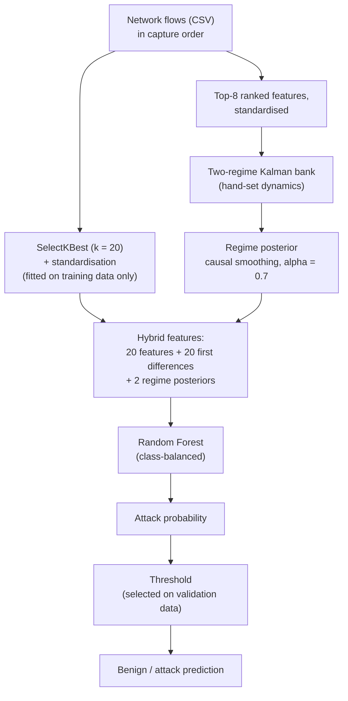

<div align="center">

# PARD-SSM: Reproduction, Evaluation & Interactive Explorer

**Probabilistic Attack Regime Detection in Network Traffic Using Switching State-Space Models**

[](https://pard-ssm-probabilistic-attack-regim.vercel.app/)


[](https://arxiv.org/abs/2604.02299)
[](https://doi.org/10.5281/zenodo.19697928)

An independent reproduction, time-ordered re-evaluation and interactive web platform for PARD-SSM, evaluated on **CICIDS2017** and **UNSW-NB15**.

**[Open the live Explorer →](https://pard-ssm-probabilistic-attack-regim.vercel.app/)**

</div>

---

## Highlights

- **PARD-SSM Explorer** is a public research platform with real model inference. It lets you run the trained pipelines on a demo sample or your own CSV, inspect the inferred regimes, and compare reported and reproduced results.
- **Two separate, validated pipelines**, one for CICIDS2017 and one for UNSW-NB15. Each has its own feature schema, preprocessing, regime filter, Random Forest and decision threshold. Exported artifacts are reloaded and checked to reproduce the held-out predictions exactly.
- **A time-ordered, leakage-free re-evaluation** that is kept strictly separate from the original repository-reported results.
- **Transparent findings.** In the new evaluation the SSSM regime features carry signal on their own but do not improve on a Random Forest alone. See [Section 5](#5-results).

**Newly reproduced held-out results** (chronological train / validation / test split, threshold chosen on validation, single seed):

| Held-out test | CICIDS2017 | UNSW-NB15 |
| :-- | --: | --: |
| Random Forest only, F1 | **0.924** | 0.834 |
| Hybrid (RF + SSSM), F1 | 0.873 | **0.836** |
| Random Forest only, ROC-AUC | 0.989 | **0.995** |
| Hybrid (RF + SSSM), ROC-AUC | **0.993** | 0.993 |
| SSSM regime posterior alone, ROC-AUC | 0.804 | 0.915 |

**Original repository-reported results** (random 80/20 split of 50,000 sampled rows stored in shuffled order; not reproduced here, see [Section 5.2](#52-original-repository-reported-experiments)):

| | CICIDS2017 | UNSW-NB15 |
| :-- | --: | --: |
| Hybrid SSSM + RF, F1 | 0.9607 | 0.9438 |
| Hybrid SSSM + RF, ROC-AUC | 0.9981 | 0.9996 |

> [!IMPORTANT]
> The two tables use different data preparation and are **not comparable**. The original sampling stored rows in shuffled order, so sequence-based metrics such as detection lead time do not reflect real temporal detection. This repository makes no early-detection claim.


## Quick Start

**Use the hosted Explorer:** open <https://pard-ssm-probabilistic-attack-regim.vercel.app/>. The backend runs on a free Render instance that sleeps when idle, so the first request after a quiet period can take up to a minute. If the backend is unreachable, the site shows clearly labelled *Precomputed Model Results — Not Live Inference*.

**Run it locally** (trained artifacts are committed, so no retraining is needed):

```bash
git clone https://github.com/PeerAhammad/PARD-SSM-Probabilistic-Attack-Regime-Detection.git
cd PARD-SSM-Probabilistic-Attack-Regime-Detection
python -m venv .venv
source .venv/bin/activate          # Windows (PowerShell): .venv\Scripts\Activate.ps1

# Backend (terminal 1, from the repository root)
pip install -r backend/requirements.txt
uvicorn backend.app.main:app --port 8000

# Frontend (terminal 2)
cd frontend
npm install
npm run dev                        # http://localhost:5173
```

---

## Table of Contents

1. [Overview](#1-overview)
2. [PARD-SSM Explorer](#2-pard-ssm-explorer)
3. [Methodology](#3-methodology)
4. [Datasets and Experimental Protocol](#4-datasets-and-experimental-protocol)
5. [Results](#5-results)
6. [Repository Structure](#6-repository-structure)
7. [Installation and Usage](#7-installation-and-usage)
8. [Deployment](#8-deployment)
9. [Limitations](#9-limitations)
10. [Citation and Attribution](#10-citation-and-attribution)
11. [License](#11-license)

---

## 1. Overview

PARD-SSM models network traffic as a latent dynamical system. Rather than classifying each flow in isolation, a **Switching State-Space Model (SSSM)** tracks hidden states and changing regimes over a sequence of observations. The regime posteriors are then combined with flow features in a Random Forest classifier.

This repository contains:

- the original research implementation (`src/`, `experiments/`) with baseline comparisons (HMM, Isolation Forest, LSTM), ablations and significance tests;
- an **order-preserving data pipeline and train/export procedure** with a chronological split (`src/data_processing/loaders_v2.py`, `src/pipeline/`, `scripts/`);
- exported, independently loadable **model artifacts** for both datasets (`artifacts/`);
- a stateless **FastAPI inference service** (`backend/`);
- the **PARD-SSM Explorer** web application (`frontend/`).

> [!NOTE]
> This is a reproduction and extension, not a claim of exact replication of every result or preprocessing decision in the original paper.

## 2. PARD-SSM Explorer

**Live site:** <https://pard-ssm-probabilistic-attack-regim.vercel.app/>

The Explorer is designed as an academic showcase and a lightweight analytics dashboard. It never fabricates predictions: every probability, regime and metric comes from the exported models, or from a clearly labelled precomputed run of the same models.

| Page | What it provides |
| :-- | :-- |
| **Overview** | Project summary, headline results (new held-out and repository-reported, shown separately), datasets, architecture |
| **Live Demo** | Dataset selector, preloaded demo sample, CSV upload with column validation, prediction table with CSV download, probability distribution, confusion matrix and metrics when labels are present |
| **Regime Explorer** | Attack probability timeline, regime posterior, latent-state magnitude, state uncertainty, regime transition counts and per-regime summary, using neutral labels (Regime 1 / Regime 2) |
| **Results** | Repository-reported results, then the newly reproduced held-out evaluation: ablation, ROC and precision-recall curves from real predictions, confusion matrix, per-class flag rates |
| **Methodology and Limitations** | Equations, pipeline, limitations, reproduction commands, citation and licence |

**Design principles**

- Regimes are **neutral filter states**, not attack families. They are not named after attacks because they were not learned or validated against attack categories.
- An attack probability is a model output, not a verified classification.
- Evaluation metrics appear only when ground-truth labels are supplied.
- Each dataset has its own model. A CICIDS2017 model never scores UNSW-NB15 traffic, or the reverse.
- The interface is light-themed with text and chart colours chosen to meet WCAG AA contrast ratios.

### API

The backend is stateless: nothing is stored between requests.

| Endpoint | Purpose |
| :-- | :-- |
| `GET /api/health` | Backend status and per-dataset model availability |
| `GET /api/demo` | Datasets, feature schemas, thresholds, reported metrics and regime definitions |
| `POST /api/predict` | Validates input, runs the dataset-specific pipeline, returns predictions, probabilities, regime timelines and (with labels) evaluation metrics |

`POST /api/predict` is `multipart/form-data` with `dataset` (`cicids2017` or `unswnb15`) and either `use_demo=true` or a CSV `file`:

```bash
# Demo sample
curl -X POST https://pard-ssm-api-7hs9.onrender.com/api/predict \
     -F dataset=cicids2017 -F use_demo=true

# Your own CSV
curl -X POST https://pard-ssm-api-7hs9.onrender.com/api/predict \
     -F dataset=unswnb15 -F file=@my_traffic.csv
```

**Input requirements**

- A header row containing the dataset's exact feature columns (leading and trailing spaces are ignored; extra columns are ignored). The required columns are listed in `artifacts/<dataset>/feature_schema.json` and in the Live Demo page.
- All values numeric, finite and non-missing. Incompatible files are rejected with an explanatory error; rows are never dropped silently, because order matters.
- Rows in capture order: the regime filter reads the file as one sequence and starts from a fresh state at the first row.
- An optional `Label` column (0/1, or text where `BENIGN`/`Normal` means benign) enables evaluation metrics.
- At most 5,000 rows and 10 MB per request. The data contains no flow identifier, so the row index is used.

## 3. Methodology

### 3.1 Mathematical formulation

Continuous hidden-state dynamics are conditioned on a discrete regime $s_t$:

$$
x_t = A_{s_t}\, x_{t-1} + w_t \qquad \text{(state dynamics)}
$$

$$
y_t = C_{s_t}\, x_t + v_t \qquad \text{(observation model)}
$$

| Symbol | Meaning |
| :-- | :-- |
| $x_t$ | Hidden system state |
| $y_t$ | Observed (standardised) network features |
| $s_t$ | Discrete regime |
| $A_{s_t}$ | Regime-specific transition dynamics |
| $C_{s_t}$ | Observation matrix |
| $w_t,\ v_t$ | Process and observation noise |

Regime transitions follow a Markov transition matrix.

### 3.2 Hybrid pipeline



**Implementation details** (`src/pipeline/hybrid.py`)

| Component | Configuration |
| :-- | :-- |
| Feature selection | `SelectKBest(f_classif, k=20)`, fitted on training data |
| Regime filter input | 8 highest-scoring features, standardised |
| Regime 1 | $A = 0.95\,I$, $Q = 0.001\,I$ (near-stationary, low noise) |
| Regime 2 | $A = 1.5\,I$, $Q = 0.5\,I$ (high-gain, high noise) |
| Observation model | $C = I$, $R = 0.2\,I$; regime stay probabilities 0.90 and 0.85 |
| Smoothing | Causal exponential smoothing, $\alpha = 0.7$ |
| Classifier | Random Forest, 100 trees, depth 20, class-balanced; minority class oversampled to parity on training data only |
| Threshold | Probability maximising F1 on the validation split |

The Kalman filter parameters and the transition matrix are **set by hand, not learned**. The regime filter starts from a fresh state at the first row of every sequence, both in evaluation and at inference.

### 3.3 Two distinct tasks

1. **Regime inference:** what the SSSM infers about latent network behaviour.
2. **Attack detection:** how well the hybrid pipeline separates malicious from benign traffic.

Standalone regime-based scores must not be confused with hybrid detection performance.

## 4. Datasets and Experimental Protocol

| Dataset | Ordering used | Features | Rows after preparation | Attack share |
| :-- | :-- | --: | --: | --: |
| CICIDS2017 | File order within each daily capture file (no timestamp column) | 52 | 53,884 | 21.0% (train) / 14.3% (val) / 5.3% (test) |
| UNSW-NB15 | Sorted by the dataset's start-time field (`Stime`) | 38 | 42,898 | 2.0% (train) / 7.0% (val) / 6.2% (test) |

**Protocol for the new evaluation** (`src/data_processing/loaders_v2.py`, `scripts/export_artifacts.py`):

1. Load the raw files in capture order. Order is never shuffled.
2. Binary target: any non-benign label is an attack.
3. Remove incomplete or non-finite rows and exact duplicates within each file.
4. Systematically sample every 47th row of the ordered stream, which preserves order.
5. Split **chronologically 60 / 20 / 20** (train / validation / test) inside every CICIDS2017 daily file, and over the whole `Stime`-sorted UNSW-NB15 stream, with a 20-row embargo between splits.
6. Fit feature selection and standardisation on training data only, select the threshold on validation data only, and evaluate once on the held-out test partition.
7. Train three variants: Random Forest only, RF with temporal differences, and the full hybrid.

Results are deterministic for the same raw files and library versions (`random_state = 42`).

**Raw data layout.** CICIDS2017 daily CSV files (the `MachineLearningCVE` files) anywhere under `data/raw/`, and `UNSW-NB15_1.csv` to `UNSW-NB15_4.csv` (headerless, as distributed) under `data/raw/`. See [`docs/dataset_guide.md`](docs/dataset_guide.md).

## 5. Results

### 5.1 Newly reproduced held-out evaluation

All numbers come from the held-out test partition. Each variant uses its own validation-selected threshold. The full hybrid's thresholds are 0.654 (CICIDS2017) and 0.269 (UNSW-NB15). The same metrics are available interactively on the Explorer's Results page, including ROC and precision-recall curves.

**CICIDS2017** (10,620 test rows, 5.3% attacks, about 560 attack rows)

| Variant | Precision | Recall | F1 | FPR | ROC-AUC | PR-AUC |
| :-- | --: | --: | --: | --: | --: | --: |
| Random Forest only | 0.971 | 0.881 | **0.924** | 0.001 | 0.989 | **0.952** |
| RF + temporal differences | 0.945 | 0.819 | 0.877 | 0.003 | 0.991 | 0.936 |
| Hybrid: RF + differences + SSSM posteriors | **0.974** | 0.792 | 0.873 | 0.001 | **0.993** | 0.940 |

**UNSW-NB15** (8,560 test rows, 6.2% attacks)

| Variant | Precision | Recall | F1 | FPR | ROC-AUC | PR-AUC |
| :-- | --: | --: | --: | --: | --: | --: |
| Random Forest only | **0.728** | 0.977 | 0.834 | **0.024** | **0.995** | **0.916** |
| RF + temporal differences | 0.720 | **0.992** | 0.835 | 0.026 | 0.993 | 0.874 |
| Hybrid: RF + differences + SSSM posteriors | 0.724 | 0.989 | **0.836** | 0.025 | 0.993 | 0.874 |

The regime posterior used alone reaches a test ROC-AUC of **0.804** on CICIDS2017 and **0.915** on UNSW-NB15.

**Findings**

- The SSSM regime posterior carries real signal on its own, but it is largely redundant with the flow features. **No SSSM advantage in attack detection is demonstrated.**
- On CICIDS2017, the Random Forest alone has the highest F1 and recall. The hybrid has a slightly higher ROC-AUC but lower recall at the chosen threshold.
- On UNSW-NB15, the three variants are within 0.002 F1 of each other.
- These are single-seed results on small test sets. Differences of a few hundredths should be treated as noise.
- Early-detection performance is **not claimed**: no validated temporal early-detection experiment supports it.

### 5.2 Original repository-reported experiments

> [!WARNING]
> These experiments are preserved for transparency, not as evidence of chronological detection performance. The processed arrays were built by randomly sampling 50,000 rows **before** the 80/20 split, and the rows are stored in shuffled order. A diagnostic confirmed it: the probability that a flow is an attack given that the previous one was is about the base rate (0.202 vs 0.197 on CICIDS2017, 0.027 vs 0.021 on UNSW-NB15). Metrics that depend on sequence order, including **detection lead time**, are therefore not temporally meaningful. The arrays also could not be regenerated from the raw files by the legacy loader (see [Limitations](#9-limitations)).

**Hybrid SSSM + RF**, decision threshold 0.5:

| Metric | CICIDS2017 | UNSW-NB15 |
| :-- | --: | --: |
| Accuracy | 98.41% | 99.75% |
| Attack Precision | 93.95% | 90.13% |
| Attack Recall | 98.28% | 99.06% |
| F1-Score | 0.9607 | 0.9438 |
| ROC-AUC | 0.9981 | 0.9996 |
| PR-AUC | 0.9937 | 0.9823 |
| Detection lead time (sequence steps, **not valid**, see above) | 28.32 ± 14.26 | 31.24 ± 13.52 |

Standalone Switching SSM regime classification accuracy was 79.81% (CICIDS2017) and 95.23% (UNSW-NB15). This measures regime inference, not attack detection.

**Baseline comparison** (original configuration, 10-epoch LSTM; best per column in **bold**)

*CICIDS2017*

| Method | Precision | Recall | F1-Score | ROC-AUC | PR-AUC |
| :-- | --: | --: | --: | --: | --: |
| HMM | 0.1780 | 0.0451 | 0.0719 | 0.4947 | 0.1946 |
| Isolation Forest | 0.7444 | 0.3170 | 0.4446 | 0.7041 | 0.4786 |
| LSTM | 0.1977 | 0.9504 | 0.3273 | 0.5058 | 0.2010 |
| **Switching SSM + RF** | **0.9390** | **0.9828** | **0.9604** | **0.9982** | **0.9936** |

<p align="center"></p>

*UNSW-NB15*

| Method | Precision | Recall | F1-Score | ROC-AUC | PR-AUC |
| :-- | --: | --: | --: | --: | --: |
| HMM | 0.0190 | 0.0896 | 0.0314 | 0.5008 | 0.0210 |
| Isolation Forest | 0.2756 | 0.3302 | 0.3004 | 0.9723 | 0.2775 |
| LSTM | 0.0214 | 0.5425 | 0.0413 | 0.4975 | 0.0208 |
| **Switching SSM + RF** | **0.9013** | **0.9906** | **0.9438** | **0.9996** | **0.9826** |

<p align="center"></p>

The baselines were **not** re-run under the chronological protocol of Section 5.1. The UNSW-NB15 HMM run produced a likelihood non-convergence warning, and the LSTM results depend on the 10-epoch configuration.

**Original ablation** (lead time omitted for the reason above)

| Dataset | Configuration | Recall | F1-Score | ROC-AUC | PR-AUC |
| :-- | :-- | --: | --: | --: | --: |
| CICIDS2017 | RF Only | 0.9853 | 0.9570 | 0.9979 | 0.9917 |
| | RF + Difference | 0.9828 | 0.9604 | 0.9981 | 0.9935 |
| | RF + SSSM | 0.9808 | 0.9613 | 0.9983 | 0.9940 |
| | RF + Difference + SSSM (full) | 0.9828 | 0.9607 | 0.9981 | 0.9935 |
| UNSW-NB15 | RF Only | 0.9764 | 0.9409 | 0.9997 | 0.9809 |
| | RF + Difference | 0.9764 | 0.9388 | 0.9996 | 0.9817 |
| | RF + SSSM | 0.9858 | 0.9457 | 0.9997 | 0.9877 |
| | RF + Difference + SSSM (full) | 0.9906 | 0.9438 | 0.9996 | 0.9826 |

<p align="center">
  
  
</p>

Values in this section come from separate script runs and may differ slightly from each other.

## 6. Repository Structure

```text
PARD-SSM/
├── artifacts/                      # exported, independently loadable pipelines
│   ├── cicids2017/
│   └── unswnb15/                   #   feature_selector.joblib, scaler.joblib, random_forest.joblib,
│                                   #   switching_ssm.joblib, threshold.json, feature_schema.json,
│                                   #   model_config.json, metrics.json, demo_sample.csv
├── backend/                        # FastAPI inference service
│   ├── app/main.py
│   ├── requirements.txt
│   └── pins.txt                    # library versions the artifacts were trained with
├── frontend/                       # React + TypeScript + Vite + Tailwind + Recharts
│   ├── src/                        #   App shell, shared UI, five pages
│   └── public/                     #   precomputed fallback results, sample CSVs
├── scripts/
│   └── export_artifacts.py         # train, evaluate, export and verify one dataset
├── src/
│   ├── data_processing/            # loaders_v2.py (order-preserving), legacy loader, feature engineering
│   ├── pipeline/hybrid.py          # shared training / inference code for the hybrid pipeline
│   ├── inference/                  # Kalman, EKF, UKF, variational switching SSM
│   ├── models/                     # linear / nonlinear / switching SSM (original research code)
│   ├── explainablity/              # SHAP analysis
│   └── utils/
├── experiments/                    # baselines, ablations, significance tests (original research)
├── results/                        # original figures and significance outputs
├── docs/                           # dataset guide, derivations, screenshots
├── tests/                          # unit tests and API tests
├── requirements.txt
├── LICENSE
└── README.md
```

Raw datasets, processed arrays and temporary outputs are excluded from Git. The exported artifacts are committed so the API runs without retraining.

## 7. Installation and Usage

Requires **Python 3.10+** (the artifacts were exported with the versions in `backend/pins.txt`) and **Node.js 18+** for the frontend.

```bash
git clone https://github.com/PeerAhammad/PARD-SSM-Probabilistic-Attack-Regime-Detection.git
cd PARD-SSM-Probabilistic-Attack-Regime-Detection
python -m venv .venv
source .venv/bin/activate          # Windows (PowerShell): .venv\Scripts\Activate.ps1
pip install -r requirements.txt    # full research environment
```

### 7.1 Run the Explorer locally

See [Quick Start](#quick-start). The frontend reads the API address from `VITE_API_BASE` (default `http://localhost:8000`). To allow other browser origins, set `ALLOWED_ORIGINS` (comma-separated) before starting the backend.

### 7.2 Retrain and export the pipelines

Place the raw datasets under `data/raw/` ([Section 4](#4-datasets-and-experimental-protocol)), then:

```bash
python scripts/export_artifacts.py --dataset cicids2017
python scripts/export_artifacts.py --dataset unswnb15
```

Each run loads the data, trains the three variants, evaluates on the held-out test partition, writes the artifact folder, writes a demo sample, and **reloads the exported pipeline to verify it reproduces the held-out predictions exactly**. Options: `--raw` (raw data directory), `--stride` (sampling stride, default 47), `--trees` (Random Forest size, default 100), `--out` (output directory, default `artifacts`).

### 7.3 Original research experiments

```bash
# Main Switching SSM experiment (original script, random-sample protocol)
python -m src.models.switching_ssm --data data/processed/cicids2017_features.npy \
       --labels data/processed/cicids2017_labels.npy --dataset-name CICIDS2017 --no-shap

# Baselines, ablations, significance
python experiments/baselines.py --dataset cicids2017 --lstm-epochs 10
python experiments/ablation_study.py --dataset cicids2017
python experiments/statistical_significance.py --help
```

These scripts need the processed `.npy` arrays described in [`docs/dataset_guide.md`](docs/dataset_guide.md). The same commands work for `unswnb15`.

### 7.4 Tests

```bash
python -m pytest -q                  # all tests
python -m pytest tests/test_api.py -q  # API: startup, inference on both datasets, validation, error handling
```

## 8. Deployment

The public deployment uses two independent services:

| Component | Host | Key settings |
| :-- | :-- | :-- |
| Frontend | Vercel | Root directory `frontend`, Vite preset, build `npm run build`, output `dist`, env `VITE_API_BASE=<backend URL>` |
| Backend | Render (free instance) | Build `pip install -r backend/requirements.txt`, start `uvicorn backend.app.main:app --host 0.0.0.0 --port $PORT`, health check `/api/health`, env `PYTHON_VERSION` (matching the export environment) and `ALLOWED_ORIGINS=<frontend URL>` |

Notes:

- The backend loads both model pipelines once at startup. The artifacts are packaged in the repository, so nothing depends on files written at runtime.
- Free Render instances sleep after inactivity, so the first request can take up to a minute. The frontend waits for the backend, then falls back to the labelled precomputed results if it cannot connect.
- `ALLOWED_ORIGINS` must exactly match the deployed frontend origin (scheme and host, no trailing slash).

## 9. Limitations

- **Original results.** The repository-reported experiments use randomly sampled, shuffled-order data. They cannot be read as chronological detection performance, and their lead-time figures are not temporally valid. The processed arrays could not be regenerated from the raw files with the legacy loader (`src/data_processing/dataset_loader.py`): its CICIDS2017 column names no longer match after header stripping, and it cannot read the headerless UNSW-NB15 files. `loaders_v2.py` replaces it for the Explorer.
- **New evaluation.** One seed and one split. The split is chronological *within* each capture session, so it does not test generalisation to unseen days or unseen attack families. CICIDS2017 has no timestamp column, so file order is only a proxy for capture order.
- **Sampling.** Data were de-duplicated and sampled 1 in 47 to about 54,000 (CICIDS2017) and 43,000 (UNSW-NB15) rows. Rare classes such as Heartbleed and Infiltration are largely or entirely absent, and the sampled stream is coarser than real traffic.
- **Small test sets.** The CICIDS2017 test partition holds about 560 attack rows. UNSW-NB15's attack share is 2.0% in training versus 6.2% in test, and its attack share falls sharply after de-duplication, so its threshold and precision are less reliable. UNSW-NB15 uses 38 features computed from the raw files, not the 36 of the legacy arrays.
- **Model.** The Kalman parameters and transition matrix are hand-set. Regimes are neutral filter states, not validated attack families. The SSSM features do not improve on a Random Forest alone.
- **Explorer.** Models accept only data with the exact feature schema they were trained on. Each request is processed as one independent sequence (at most 5,000 rows) with a fresh filter state. Free-tier hosting means cold starts and no availability guarantee.
- **Deployment.** These are research models trained on 2015 and 2017 benchmark datasets. Strong benchmark results do not establish production readiness; independent chronological captures and live traffic are still needed. Detection lead time, where mentioned, is in sequence steps, not seconds.

## 10. Citation and Attribution

This repository is derived from and builds on the original PARD-SSM research.

- **Preprint:** [arXiv:2604.02299](https://arxiv.org/abs/2604.02299)
- **Original project DOI:** [10.5281/zenodo.19697928](https://doi.org/10.5281/zenodo.19697928)

The original research and its authors retain their attribution. The experiment scripts, order-preserving data pipeline, held-out evaluation, exported artifacts, inference service and web application in this repository are separate reproduction and extension work.

If you use this work, please cite the original paper and this repository:

```bibtex
@misc{pardssm2026,
  title         = {PARD-SSM: Probabilistic Cyber-Attack Regime Detection via Variational Switching State-Space Models},
  year          = {2026},
  eprint        = {2604.02299},
  archivePrefix = {arXiv},
  url           = {https://arxiv.org/abs/2604.02299},
  note          = {Author list as given on the arXiv page}
}

@misc{pardssm_explorer,
  title        = {PARD-SSM: Reproduction, Evaluation and Interactive Explorer},
  year         = {2026},
  howpublished = {\url{https://github.com/PeerAhammad/PARD-SSM-Probabilistic-Attack-Regime-Detection}},
  note         = {Independent reproduction and web platform; live demo at https://pard-ssm-probabilistic-attack-regim.vercel.app/}
}
```

Datasets: **CICIDS2017** (Canadian Institute for Cybersecurity, University of New Brunswick) and **UNSW-NB15** (UNSW Canberra Cyber). Please follow their respective terms and cite them when using the data.

## 11. License

Released under the original **Apache License 2.0**. See [`LICENSE`](LICENSE) for the full terms, and preserve the license and attribution notices when redistributing this derivative work.

---

<div align="center">

*Independent reproduction, chronological evaluation and interactive exploration of probabilistic attack-regime detection.*

</div>
